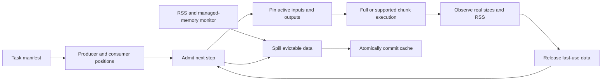

# Resource planner and spill runtime

BioPipe uses a fixed-order resource planner. Existing YAML tasks retain legacy
execution unless `runtime.memory` or a memory CLI override enables management.
Studio enables it by default. The analysis implementations remain CPU-based.

## Configuration

```yaml
runtime:
  memory:
    enabled: true
    budget_mb: 512
    process_limit_mb: 1536
    disk_limit_mb: 4096
    target_fraction: 0.70
    spill_fraction: 0.85
    auto_spill: true
    poll_ms: 100
    chunk_mb: 4
    io_buffer_kb: 64
    keep: [pcs]
    # cache_dir: cache   # relative to the task; each run gets a subdirectory
    # profiles:
    #   pca: {workspace_mb: 256, output_mb: 8}
```

`mb` and `kb` mean MiB and KiB. `budget_mb` covers managed data, metadata and estimated
additional workspace/output, excluding the interpreter/imported-library baseline.
`process_limit_mb` samples whole-process RSS and must exceed that baseline. These
are different budgets, not interchangeable memory measurements.

Without an explicit budget, available physical memory is scanned **once just before
execution**: use 25%, capped at 2 GiB. Manifest validation, Studio editing and export
do not scan available RAM. Budget and execution order remain fixed during a run;
actual sizes refine step admission and emergency spill reacts to pressure without
repeated system-free-memory scans.

```text
python scripts/verify_memory.py
python scripts/run.py .verification/resource_demo/managed --memory-mb 128 --process-memory-mb 512
```

CLI overrides include `--memory-mb`, `--process-memory-mb`, `--disk-mb`, `--cache-dir`
and `--no-auto-spill`. Disabling automatic spill disables pressure eviction and
background spill monitoring; successful runs still persist requested outputs.
`keep` retains selected intermediate Forms; terminal outputs are also retained.
Unneeded data and temporary disk copies are released after the last consumer.

## Execution and complexity



1. Traverse the manifest once to index producers and consumer positions. Execute
   the original fixed order; branches and merges are represented by input names.
2. Pin current inputs, load sources/reload disk copies on demand and account for
   real arrays, labels and metadata. Shared NumPy backing allocations count once.
3. Reserve extra workspace/output. If necessary, evict the item with the furthest
   next use, breaking ties in favor of larger items. Active inputs and outputs
   being exported cannot be evicted.
4. Reject a full-memory step with `MemoryBudgetError` if its estimated admission
   cannot fit. Registered outputs replace reservations with their actual size;
   same-named outputs receive new artifact version IDs.
5. Observed RSS increments can raise future workspace estimates for the same
   operator. RSS includes outputs/allocator effects, so this is conservative feedback,
   not a causal measurement of scratch memory alone.

Index construction is O(steps + references + declared outputs). Next use is queried
by binary search; eviction uses a priority queue with stale-entry rebuilding.
There is no exponential subset enumeration and no claim of globally minimal I/O
or execution time. Public plugin estimators return `(workspace_bytes, output_bytes)`
through `Step.estimate_memory`; see [protocol](operator_protocol.md).

`ctx.memory.update_budget(bytes)` remains an explicit API at step boundaries.
Studio/default execution never calls it automatically. Shrinking attempts immediate
eviction; failure restores the prior budget and logs a reason. Updates during an
active step are rejected.

## Chunking and emergency spill

Only `describe` currently has a real chunk implementation. It reads cached `.npy`
blocks and computes finite counts, extrema, mean and population standard deviation.
It combines block moments in float64; rounding may differ from the original float32
calculation. Chunk size depends on dtype, available reservation and `chunk_mb`,
including the block, finite-value selection and statistical temporary arrays.

PCA, regression, filters, joins and the newer analysis operators use full arrays.
The internal chunk scheduler is specific to a single real input and describe's
buffer model. New external SDK plugins cannot enable streaming with a flag: v1
rejects it until a generic chunk API is available.

A background thread samples RSS/managed usage every `poll_ms`. Above the spill
threshold it attempts eviction toward `target_fraction`, rate-limiting repeated
pressure attempts. Disk quota/write failure retains the in-memory original and
records `spill_blocked`. A subsequent inadmissible step fails explicitly.

RSS sampling cannot guarantee absence of OOM. Readers still initially materialize
complete sources, whose size may be unknown before allocation. Active NumPy/BLAS
scratch allocations cannot be interrupted/spilled. Estimates are not proven upper
bounds. General reader chunks and process-level enforcement remain future work.

## Cache format and consistency

- Numeric arrays use non-object `.npy`, preserving dtype/shape. Main data is written
  in C order with bounded buffers instead of first copying the complete array.
- `metadata.pkl` preserves dimensions, labels, info, axis_info and encoder objects;
  array metadata is stored through separate `.npy` references. Pickle is read only
  from private caches generated by this run. There is no external pickle import or
  cross-run computation-cache interface; never replace these files with untrusted data.
- Writes go into `.pending-*`, flush/fsync, then atomically rename the directory.
  Memory is released only after commit. Quota, short-write or rename failures clean
  incomplete output and retain the original memory copy.
- Same-named Form versions have distinct IDs/directories. Registered data is read-only;
  return a new Form and treat input metadata as immutable. Hidden dependencies or
  mutation through extra references violate cache/lifetime guarantees.
- Disk quota applies to this run's cache, not historical run directories. Retained
  terminal outputs accumulate until the user cleans old runs.

## Audit outputs

```text
output/
  operators.json
  run_summary.json
  run_summary.txt
  runs/<run_id>/
    pipeline.json
    events.jsonl
    memory_report.json
    run_summary.json
    steps/*.json
    figures/*
    cache/<artifact_id>/
      data.npy
      metadata.pkl
      info-*.npy
```

Events record source paths, artifact IDs, producer/reuse positions, spills, reloads
and failures. Memory reports include budgets, peaks, plans, final artifact locations
and pipeline SHA-256. Custom `cache_dir` uses `<run_id>/<artifact_id>` and logs its
resolved location. Normal failures preserve partial summaries; an OS-killed process
may lack a final report, while earlier events/committed caches remain available.
Studio additionally records graph snapshots and `plugins.lock.json` per job.

## Verification and limits

`python -m pytest -q` covers spill/reload, noncontiguous arrays, metadata, shared
allocations, pinned inputs, versions, admission, budget changes, RSS pressure, quotas,
failed commits and run isolation. `python scripts/verify_memory.py` generates CSVs,
compares legacy/managed branched selection, PCA, concat and chunk statistics, and
checks unused sources are not read. Evidence is written under
`.verification/resource_demo/verification.json`.

An in-memory genotype fixture exercises all 16 GWAS steps and checks QC, PCA,
regression, correction, annotation and three figures; it bypasses the VCF reader.
These are small deterministic fixtures with tight budgets, not large cohort stress
tests. They do not validate CUDA, general streaming or every optional native format.
